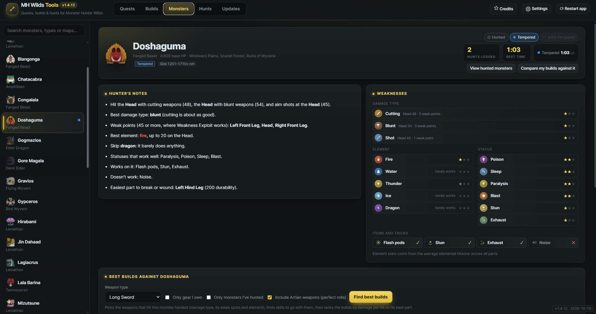
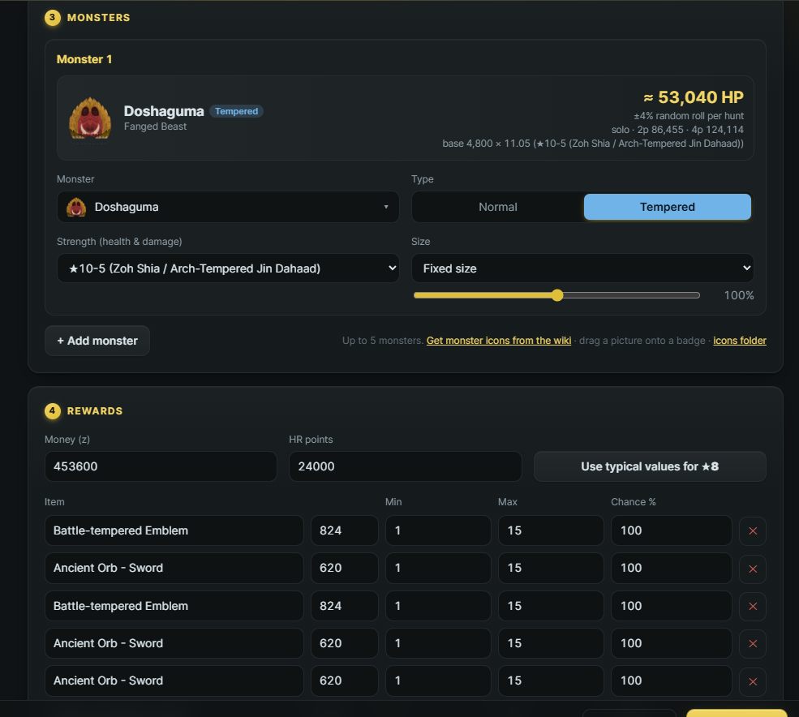
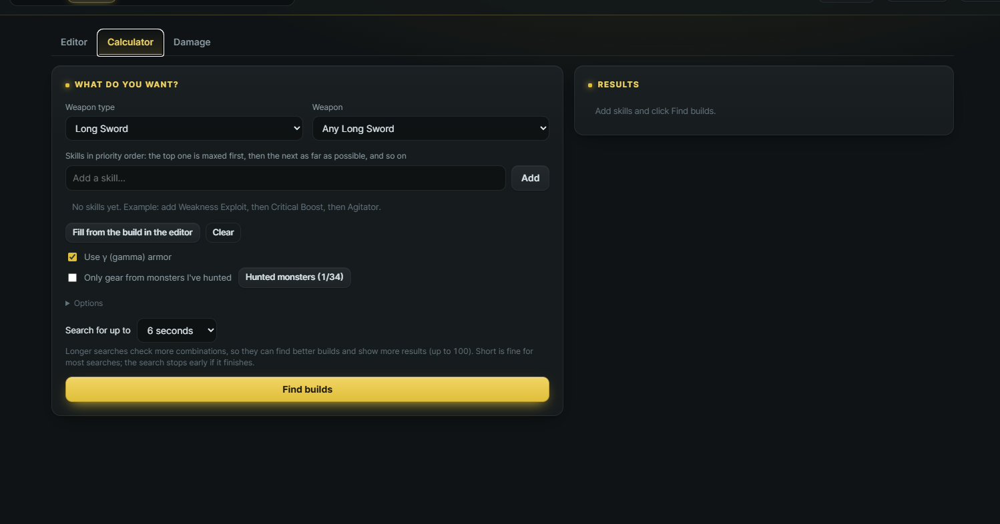
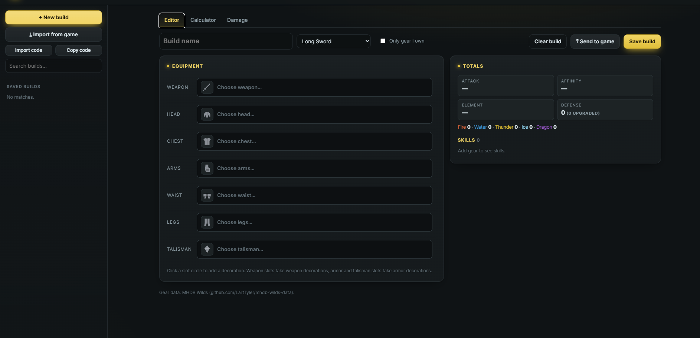
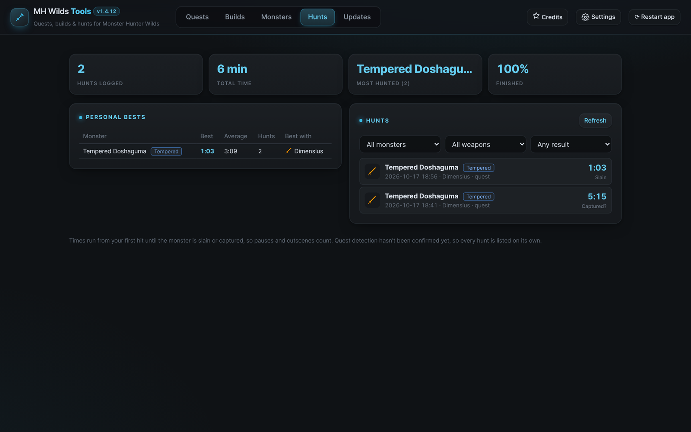

# MH Wilds Tools

Custom quests, build planning, monster guides and a hunt log for Monster Hunter Wilds on PC.

[Download](https://github.com/waycaar/mhwilds-tools/raw/main/releases/MHWildsTools.exe) · [Setup guide](#setup) · [How to use it](#how-to-use-it) · [Troubleshooting](#troubleshooting) · [Changelog](CHANGELOG.md) · [Source](#source-code) · [Credits](#credits-and-thanks)

## What it does

| | |
|---|---|
| **Quests** | Make your own event quests: up to five monsters, normal, tempered or arch-tempered, any star rating and strength, size, time limit and rewards. Installs in one click. |
| **Builds** | A build editor, a calculator that finds gear for the skills you want in priority order, and a damage tab to compare builds against any monster. Imports your gear from the game and can send a build back into an empty loadout slot. |
| **Monsters** | A guide for every large monster: where to hit, best damage type, element and statuses, what it attacks with, items that work, hitzones and drops. It can also find the best builds against that monster. |
| **Hunts** | A log of every large monster you fight, with times, personal bests and the gear you used. |

Monster health for every quest strength is built into the app, read from the game's own data. The game script that comes with it is small and only reads what it needs for loadouts and the hunt log.

<table>
<tr><td width="50%"></td><td width="50%"></td></tr>
<tr><td align="center">Quest maker, with health worked out for each strength</td><td align="center">Build calculator</td></tr>
<tr><td></td><td></td></tr>
<tr><td align="center">Build editor</td><td align="center">Hunt log</td></tr>
</table>

## Setup

The same guide is in [README.txt](README.txt) if you'd rather read it offline.

### What you need

| | Needed for |
|---|---|
| Windows 10 or 11 and Monster Hunter Wilds on PC | Everything |
| [REFramework](https://github.com/praydog/REFramework/releases) | Custom quests, gear import, sending builds, hunt log |
| [Permanent Event Quests and Custom Quest Loader](https://www.nexusmods.com/monsterhunterwilds/mods/1096) by kassent | Custom quests |

The build editor, calculator and monster guide work without any mods.

### Install

1. **Install REFramework.** Download the Monster Hunter Wilds build from the REFramework releases page and put `dinput8.dll` in your game folder, next to `MonsterHunterWilds.exe`. Start the game once. Pressing Insert should open the REFramework menu.
2. **Install the Permanent Event Quest mod** (only if you want custom quests). Follow the instructions on its Nexus page.
3. **Download [MHWildsTools.exe](https://github.com/waycaar/mhwilds-tools/raw/main/releases/MHWildsTools.exe)** and put it in its own folder, for example `Documents\MH Wilds Tools`. It's a single file and doesn't need installing.
4. **Run it.** The first time, Windows may show "Windows protected your PC". Click More info, then Run anyway. This only happens once, because the app isn't signed with a paid certificate.
5. **Check the game folder.** The app looks for your Steam game folder by itself. If the dot next to Settings is red, open Settings → Game folder → Change and pick the folder that contains `MonsterHunterWilds.exe`.
6. **Install the data reader** (optional). Open the Updates tab and click Install. It adds one script, `questmaker_reader.lua`, to `reframework\autorun`. Restart the game afterwards. You only need it for gear import, sending builds to the game and the hunt log.

### Updating

The app checks this page for new versions when it starts and asks before installing. You can also check from the Updates tab, or turn the check off in Settings. If the Updates tab says the data reader is out of date, click Update and restart the game.

## How to use it

### Make a custom quest

1. Open the Quests tab and click **+ New quest**.
2. Fill in the name, client and description. Long lines are wrapped to fit the quest board for you.
3. Pick the map, objective (hunt, slay or capture), star rating, time limit, faints and player count.
4. Add up to five monsters. For each one choose normal, tempered or arch-tempered (only offered for monsters that come that way), the strength, which sets health and damage, and the size.
5. Add rewards if you like.
6. Fix anything listed at the bottom of the window, then click **Create & install**.
7. In the game, restart, or press Insert → Script Generated UI → Permanent Event Quest → **Reload**. The quest is on the quest board under Event Quests.

Your quests are listed on the left. Click one to edit it, or use the ✕ to remove it.

### Plan a build

- **Editor:** click a slot to choose a weapon, armor or talisman, and click a slot circle to add a decoration. Totals and skills update as you go. Tick "Only gear I own" to list only what's in your last gear export.
- **Calculator:** add the skills you want, top one first. It maxes the first skill, then fits the next as far as possible, and so on. Choose a search time: longer searches check more combinations and can show up to 100 results. Click a result to open it in the editor.
- **Damage:** compare saved builds' damage per hit on every part of a monster.
- **Hunted monsters:** mark which monsters you've hunted (normal, tempered, arch-tempered) and the calculator can skip gear you can't craft yet.

### Import your gear and send builds to the game

These need the data reader.

1. Start the game and load your save. Your gear is exported automatically a few seconds after you load in, and again whenever your gear or loadouts change.
2. In the Builds tab, click **Import from game** to load your loadouts.
3. To send a build, open it in the editor and click **Send to game**. In the game, press Insert and click **Write to empty loadout slot**. It only ever uses an empty slot, the app backs up your save first when it can, and you can undo it from the same menu.

### Monster guide

Pick a monster on the left. Monsters and Guardian monsters are listed separately. The page shows where to hit with each damage type, weak points, element and status ratings, what it attacks with and what works on it. Use **Find best builds** to rank builds against that monster, optionally limited to gear you own or can craft, with Artian weapons included.

### Hunt log

With the data reader installed, every large monster you fight is logged from your first hit until it's slain or captured. The Hunts tab shows your times, personal bests and the weapon you used. Each monster's page shows how many times you've hunted it and your best time.

## Troubleshooting

| Problem | What to do |
|---|---|
| "Windows protected your PC" | Click More info → Run anyway. It only shows on the first run. |
| The game folder isn't found | Settings → Game folder → Change, and pick the folder with `MonsterHunterWilds.exe`. |
| The quest doesn't show up in the game | Check the Permanent Event Quest mod is installed (the app warns you if it isn't), then restart the game or use Reload in the REFramework menu. |
| Import from game finds no gear | Load into your save and wait a few seconds. Or press Insert → MH Wilds Tools data reader → Export my gear now. |
| Send to game says there's no empty slot | Free up a loadout slot in the game first. The app never overwrites one of yours. |
| The Hunts tab is missing | It hides itself until the data reader is installed. You can force it on in Settings → Tabs. |
| "No official quest for this map was found" | The app builds each quest from an official quest that comes with the Permanent Event Quest mod. Reinstall that mod (including its quests folder), or pick another map. |
| The window opens in a browser | Install Microsoft Edge WebView2 Runtime from Microsoft. It's already on most Windows 10 and 11 PCs. |

## Privacy and files

- The app runs locally. It only goes online to check this repository for updates when it starts (you can turn that off in Settings), and to fetch monster icons from monsterhunterwiki.org if you click "Get monster icons from the wiki" in the Quests tab.
- Settings, saved builds, hunted monsters and save backups are kept in `%APPDATA%\MHWildsQuestMaker`.
- In your game folder it only writes quest files to `reframework\plugins\PermanentEventQuest\quests`, the data reader to `reframework\autorun`, and the reader's own files to `reframework\data\questmaker`.
- The data reader reads your equipment, loadouts and the monsters you fight. It only changes your save when you click Write to empty loadout slot.

To uninstall, delete the app's folder, `%APPDATA%\MHWildsQuestMaker`, `reframework\autorun\questmaker_reader.lua` and `reframework\data\questmaker`. Your custom quests are in `reframework\plugins\PermanentEventQuest\quests`. Delete them there if you want them gone too.

## Source code

The full source is in [src](src), released under the [GPL-3.0](LICENSE). See [src/BUILD.md](src/BUILD.md) for how to build it. It's one Go program with the interface and data embedded.

## Credits and thanks

Made by **waycock**. Questions, bug reports and ideas are welcome on Discord: `waycock`.

Thanks to the people whose work this is built on:

| | |
|---|---|
| **LartTyler** | [mhdb-wilds-data](https://github.com/LartTyler/mhdb-wilds-data), the gear, skill and monster data behind the builds and the monster guide (GPL-3.0) |
| **praydog** and the REFramework contributors | [REFramework](https://github.com/praydog/REFramework), which runs the data reader and makes Wilds modding possible |
| **kassent** | [Permanent Event Quests and Custom Quest Loader](https://www.nexusmods.com/monsterhunterwilds/mods/1096), which loads the quests this app makes |
| **Rasmus Andersson** | The [Inter](https://rsms.me/inter/) typeface used in the app (SIL Open Font License) |
| **Everyone who tested early builds** | For the bug reports and screenshots |

Monster Hunter Wilds is a trademark of Capcom. MH Wilds Tools is a fan-made project and isn't affiliated with or endorsed by Capcom.
